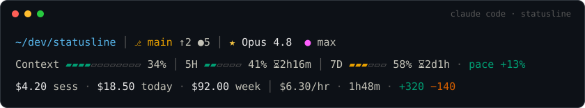

# Claude Code statusline

A flat, three-row [status line](https://code.claude.com/docs/en/statusline) for Claude Code. It shows
where you are, how much headroom is left (context, plan limits) and what the work costs (session, today,
week). It uses a colorblind-safe palette, adapts to the terminal's width, and never blocks the render on
slow work.



*(Rendered from the script's real output with sample data. Colors follow the
[Okabe–Ito](https://jfly.uni-koeln.de/color/) colorblind-safe palette.)*

---

## What the three rows show

**Row 1: where you are**
`~/dev/statusline │ ⎇ main ↑2 ●5 │ ★ Opus 5.5  ● max · ↯ fast`
- home-relative path (middle-truncated when long)
- git branch: green when clean, amber when dirty, with `↑`ahead `↓`behind `●`changed-file counts (the short
  hash when detached)
- `★` model, `●` reasoning effort (`low` … `max`), `↯ fast` when [fast mode](https://code.claude.com/docs/en/fast-mode)
  is on, and the output style when it isn't the default

**Row 2: headroom**
`Context 1M ▰▰▰▰▱▱▱▱▱▱▱▱ 34% │ 5H ▰▰▱▱▱▱ 41% ⏳2h16m │ 7D ▰▰▰▱▱▱ 58% ⏳2d1h · pace +12%`
- **Context**: share of the context window in use (input tokens, as Claude Code computes it). The window
  size is shown when it isn't the default 200k, e.g. `1M`.
- **5H / 7D**: your Pro / Max / Ultra plan's rolling 5-hour and weekly limits, with a `⏳` countdown to each
  reset
- **pace**: how your weekly use compares to a straight-line burn (see [Pace](#pace))
- **Spend**: behind a Claude apps gateway with a spend limit, a bar for that limit plus `$used/$limit`

Bars turn amber at 50%, red at 80% (`!`) and magenta at 95% (`⚠`). Each bar is labelled and always shows
its percentage, so no meaning depends on color alone.

**Row 3: cost**
`$4.20 sess · $18.50 today · $92.00 week │ $6.30/hr · api 18m · +320 −140 │ cache 91% ⏳43m`
- **sess / today / week**: spend for this session, today, and the current weekly-limit cycle (amounts of
  $100 and up drop the cents)
- **$/hr**: session spend per wall-clock hour · **api**: time spent waiting on the API · lines added/removed
- **cache**: prompt-cache hit ratio, with the time until the cache goes cold (`cache 91% cold` once it has).
  A cold cache means the next request pays to re-cache the conversation.

A segment appears only when Claude Code supplies its data. Rate limits exist only on subscription plans
and appear after the session's first API response; effort appears only for models that support it.

## Requirements

| | |
|---|---|
| **Required** | `bash` 3.2+ (the stock macOS bash works) and [`jq`](https://jqlang.org) (tested with 1.7 and 1.8) |
| **Optional** | `git` for the branch segment · [`ccusage`](https://github.com/ccusage/ccusage) **≥ 20** for the today/week figures (see [Installing ccusage](#installing-ccusage)) · a Nerd/Powerline font for the branch glyph, or set `STATUSLINE_ASCII=1` |
| **Platforms** | Linux, macOS, and Windows via Git Bash or WSL |

None of the optional pieces is fatal. Without `git` the branch is hidden; without `ccusage` only the
today/week figures are.

### Installing ccusage

Since v20, ccusage is a self-contained native program; the npm package is just a launcher for it.
Either of these works:

- **With npm:** `npm install -g ccusage@latest`.
- **Without npm or Node:** put the native binary in `~/.local/bin`. The status line searches there even
  when Claude Code was started with a minimal PATH. On Linux x64:
  ```sh
  url=$(curl -fsSL https://registry.npmjs.org/@ccusage/ccusage-linux-x64/latest | jq -r .dist.tarball)
  mkdir -p ~/.local/bin && curl -fsSL "$url" | tar -xzO package/bin/ccusage > ~/.local/bin/ccusage
  chmod +x ~/.local/bin/ccusage && ~/.local/bin/ccusage --version
  ```
  For other platforms, swap `linux-x64` for `linux-arm64`, `darwin-arm64`, `darwin-x64`, `win32-x64` or
  `win32-arm64`.

If neither is installed but `npx` or `bunx` is, each refresh fetches ccusage through them, which is
slower.

### Fonts

Every symbol is standard Unicode that ordinary fonts cover: the bars `▰▱`, `★ ● ↯ ⚠`, and `⏳` from the
system emoji font. The one exception is the branch icon ``, a Powerline symbol (U+E0A0). Without a font
that has it, it shows as a box. What matters is the font on the computer **displaying** the terminal: over
SSH that's your laptop, not the remote machine.

- **Debian / Ubuntu:** `sudo apt install fonts-powerline`. Terminals pick the symbol up through font
  fallback, so you don't need to change your terminal font. On Fedora: `sudo dnf install powerline-fonts`;
  on Arch: `sudo pacman -S powerline-fonts`.
- **macOS:** in iTerm2, tick *Settings › Profiles › Text › Use built-in Powerline glyphs*. For Terminal.app,
  install a Nerd Font (`brew install --cask font-meslo-lg-nerd-font`) and select it under
  *Settings › Profiles › Font*.
- **Windows Terminal:** install a [Nerd Font](https://www.nerdfonts.com/font-downloads) and select it under
  *Settings › Profiles › Appearance › Font face*.
- **WezTerm** ships the Nerd Font symbols built in, so there's nothing to install.
- Or skip special glyphs entirely with `STATUSLINE_ASCII=1` (see [Customization](#customization)).

## Install

**Clone** (recommended: lets you read the scripts first):
```sh
git clone https://github.com/Rubindai/statusline.git
cd statusline
./install.sh
```

**One-liner:**
```sh
curl -fsSL https://raw.githubusercontent.com/Rubindai/statusline/main/install.sh | bash
```

The installer copies two scripts into `~/.claude/statusline/` and points `statusLine` in
`~/.claude/settings.json` at them. Your other `statusLine` keys (`padding`, `hideVimModeIndicator`,
`refreshInterval`) and every other setting are kept, and the file is backed up first. It then smoke-tests
the renderer and prints a preview. Claude Code reloads settings on its own, so open sessions pick the status
line up on their next update.

**Manual:** copy `statusline-command.sh` and `cost-refresh.sh` into `~/.claude/statusline/`, `chmod +x` both,
and add:
```json
{
  "statusLine": {
    "type": "command",
    "command": "~/.claude/statusline/statusline-command.sh",
    "padding": 0,
    "refreshInterval": 60
  }
}
```

Claude Code runs `command` through a shell, so `~` expands. That keeps `settings.json` portable between
machines and works when your home path contains spaces.

`refreshInterval: 60` re-runs the script every minute even while the session is idle. That keeps the `⏳`
countdowns ticking and picks up the background cost refresh promptly. Without it, the line updates only on
Claude Code events: new messages, `/compact`, permission-mode and vim-mode changes, and the moment a rate
limit or the prompt cache expires. The installer adds `refreshInterval: 60` only if you don't already
have one. To set a value explicitly, use `STATUSLINE_REFRESH=<seconds> ./install.sh`; `0` removes it.

> If you host this under a different repo, replace `Rubindai/statusline` in the URLs above.

## How the cost figures work

- **`sess`** comes live from Claude Code (`cost.total_cost_usd`, its client-side estimate). It resets when
  `/clear` starts a new session.
- **`today` / `week`** come from [ccusage](https://github.com/ccusage/ccusage). It reads your local Claude
  Code transcripts, removes duplicates from resumed sessions, and prices each model.
  - The refresh runs **`ccusage claude daily`**, not plain `ccusage daily`. Since v20, plain `daily` also
    counts Codex, Gemini CLI, OpenCode, Amp and other agents' usage.
  - `today` is the bucket for your local date. It disappears at midnight until it is recomputed.
  - `week` is the sum since the current weekly-limit cycle began (`seven_day.resets_at − 7 days`), so it
    matches the **7D** bar. Without rate-limit data it covers the last 7 days.
- Rendering never waits on ccusage. `cost-refresh.sh` runs in the background, one at a time: at most every
  5 minutes, and straight away when the weekly cycle or the date changes. It writes
  `today week computed_at window_start next_midnight before_today` to `~/.claude/statusline/cache/cost`,
  and the status line only reads that file. If ccusage fails, the previous figures stay as long as they are
  still valid, and it retries after the same 5-minute back-off.
- **Disk use stays low.** ccusage reads every transcript touched within the dates it is asked about, which
  for a busy week can be gigabytes. So the whole window is read only once a day, and again when the weekly
  cycle changes. The spend before today is kept in the cache, and the 5-minute refreshes read only today's
  transcripts.
- **It stays out of the way.** The refresh runs at the lowest CPU priority and in the idle disk-priority
  class (`ionice -c 3` on Linux; the background policy via `taskpolicy` on macOS). It also runs in its own
  session (`setsid`), so when Claude Code cancels a render that is still running, a refresh that render
  started keeps going.

**Caveats:** these are figures **for this machine only**: other computers and claude.ai usage aren't
counted. They're **API list-price estimates**, not your subscription bill. ccusage buckets by calendar day,
so `week` starts at the beginning of the day the cycle started.

## Pace

`pace = elapsed% − used%`, where `elapsed%` is how much of the 7-day window has passed.

- **`pace +N%`** (green): you've used *N points less* than a steady burn would have. You're under budget.
- **`pace −N%`** (red): you're *N points ahead* of a steady burn, and on course to hit the weekly limit early.

It's computed locally from the `seven_day` numbers Claude Code passes in; nothing is fetched.

## Narrow terminals

Claude Code passes the terminal width in `$COLUMNS`. When a row doesn't fit, the bars shrink first (12/6 to
6/4 cells). Then the least important segments are dropped, one at a time:

| Row | Dropped first → last | Always kept |
|---|---|---|
| 1 | output style, git counts, fast, effort, branch, model | path |
| 2 | pace, reset countdowns, spend dollars, Spend, 7D, 5H | Context |
| 3 | api time, $/hr, lines, cache, week, today | sess |

## Customization

- **No color:** `NO_COLOR=1`, set in the command:
  `"command": "NO_COLOR=1 ~/.claude/statusline/statusline-command.sh"`.
- **No special glyphs** (if icons show as boxes): `STATUSLINE_ASCII=1` the same way. It uses plain ASCII
  (`git:`, `#`/`-` bar cells, `in 2h16m`, …).
- **Colors and thresholds:** the `C_*` values and the `50 / 80 / 95` cut-offs in `meter()`, at the top of
  `statusline-command.sh`.
- **Bar widths:** the `row2 12 6` call (context cells, limit cells).
- **Segment priorities:** the second argument of each `seg` call (higher is kept longer; `0` is never dropped).
- **Cost refresh rate:** `COST_TTL` (seconds).
- **Spacing:** `statusLine.padding` in `settings.json`.

## Troubleshooting

- **The status line is blank.**
  - Accept the workspace-trust prompt. Until you do, `claude --debug` logs
    `Status line command skipped: workspace trust not accepted`.
  - Make sure both scripts are executable (`chmod +x`).
  - `disableAllHooks: true` in your settings also disables custom status lines. So does an organization
    policy with `allowManagedHooksOnly`.
- **Something looks wrong.** Run the script by hand with debug output:
  `echo '{"model":{"display_name":"Opus"}}' | STATUSLINE_DEBUG=1 ~/.claude/statusline/statusline-command.sh`.
  Normally stderr is silenced, so a stray warning can't disturb Claude Code's display.
- **`today`/`week` never appear.** Check `ccusage --version` (needs ≥ 20; see
  [Installing ccusage](#installing-ccusage)), then run a refresh by hand:
  `~/.claude/statusline/cost-refresh.sh && cat ~/.claude/statusline/cache/cost`. A `-` in the cache means
  that figure is unknown, usually because ccusage couldn't be found or failed.
- **`week` is missing for a moment.** The weekly cycle or the date changed and the background refresh is
  recomputing it. It comes back on the next update.
- **The branch icon is a box.** The displaying computer has no Powerline or Nerd font; see [Fonts](#fonts),
  or use `STATUSLINE_ASCII=1`.

## Development

```sh
bash test/run.sh            # offline suite with a fake ccusage: renderer, cost refresh, installer
bash test/run.sh --bash32   # and again under bash 3.2 (the stock macOS bash) in Docker
```

The fixtures in `test/fixtures/` follow the official statusLine JSON schema. When Claude Code adds fields,
start there.

## Uninstall

```sh
./uninstall.sh            # removes the statusLine key (only if it points here; backup kept) and the scripts
./uninstall.sh --purge    # also deletes ~/.claude/statusline/, including the cost cache
```

## Credits

The today/week cost figures come from [**ccusage**](https://github.com/ccusage/ccusage) by ryoppippi. Colors
use the Okabe–Ito colorblind-safe palette.

## License

[MIT](LICENSE)
